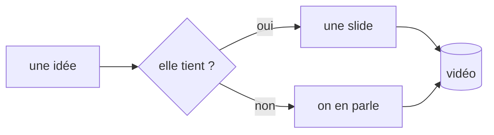

# ardoise

présenter en tapant, sans quitter le clavier

<!-- note: Slide d'ouverture. Laisser respirer 3 secondes avant de parler. Le curseur est déjà dans la slide : c'est le sujet. -->

---

## Le problème

Une idée arrive, et il faut trois outils pour la montrer.

<!-- pause -->

- un deck pour la **structure**
- un éditeur pour l'**écrire**
- un terminal pour la **prouver**

<!-- pause -->

::: warn
Trois fenêtres, c'est trois occasions de perdre le fil - et le spectateur avec.
:::

<!-- note: C'est le constat de départ. Ne pas le surjouer : une phrase suffit. -->

---

## Une seule scène

Il n'y a plus deux endroits : le curseur est **dans** la présentation.

<!-- pause -->

- `j` et `k` descendent et remontent de **paragraphe** en paragraphe
- un paragraphe, c'est un pas de slide : la navigation *est* le rythme
- `w` `b` `h` `l` affinent jusqu'au mot et au caractère

<!-- pause -->

::: key
On ne bascule pas entre « présenter » et « éditer » : on change de granularité.
:::

---

## Écrire sur place

`i` écrit dans le texte **déjà mis en forme**. Aucune fenêtre ne s'ouvre.

<!-- pause -->

```text
  j  →  ## Un titre          i  →  ## Un ti|tre
  (rendu)                          (le markdown revient
                                    sous le curseur)
```

<!-- pause -->

::: ok
`échap` rend la ligne au rendu. Le reste de la slide n'a pas bougé.
:::

<!-- note: Moment de démonstration. Écrire une vraie phrase, pas un exemple. -->

---

## Modale, vraiment

<!-- pause -->

- `w` `b` `e` : mot suivant, précédent, fin
- `0` `$` : début et fin de ligne
- `x`, `d`+mouvement, `c`+mouvement : supprimer, changer
- `u` : annuler
- `A`, `I`, `O` : fin de ligne, début de ligne, nouveau paragraphe
- `échap` : revenir au curseur, sans quitter la scène

<!-- pause -->

::: note
Les compteurs marchent : `3w`, `2x`, `d2w`.
:::

---

## Les pas

Un paragraphe par pas, ou des groupes avec `<!-- pause -->`. C'est écrit, pas cliqué.

<!-- pause -->

```markdown
- un point
<!-- pause -->
- le point suivant
```

<!-- pause -->

`espace` saute au groupe suivant ; `j` descend d'un seul paragraphe.

---

## Le code, tel quel

```nix
{ pkgs ? import <nixpkgs> {} }:
pkgs.mkShell {
  buildInputs = with pkgs; [ nodejs_22 git ];
  shellHook = ''
    npm install && npm run dev
  '';
}
```

<!-- pause -->

::: ok
La coloration ne dépend d'aucun service : tout est calculé localement.
:::

---

## Un schéma qui se dessine



<!-- pause -->

Le diagramme est du texte : il se modifie pendant la prise, comme le reste.

---

## Le clavier, en une table

| touche | geste |
|---|---|
| `j` / `k` | paragraphe suivant / précédent |
| `espace` | pas suivant (groupe) |
| `n` / `p` | slide suivante / précédente |
| `i` `a` `A` `I` `O` | écrire, sur place |
| `w` `b` `e` | mot à mot |
| `d` `w` · `c` `w` | supprimer · changer |
| `u` / `échap` | annuler · valider et rendre |
| `.` / `:` | écran noir · commandes |

<!-- note: Ne pas lire la table. Montrer deux gestes, laisser l'aide faire le reste. -->

---

## Thème et taille

`:theme paper` pour la lumière du jour, `:theme nord`, `:theme gruvbox`.

<!-- pause -->

- `+` / `-` ajustent la taille du texte par pas de 5 %
- `:size 120` la règle d'un coup, `:size reset` revient à 100 %
- un deck peut déclarer `theme: paper` dans son en-tête

<!-- pause -->

::: note
Les deux se changent en pleine prise : rien n'est rechargé, rien ne clignote.
:::

---

## Tourner proprement

- `?raw=1` masque le pied de scène **et le repère de paragraphe**
- `f` passe en plein écran
- `P` ouvre les notes sur le second écran
- `t` lance le chrono
- `s` télécharge le markdown à jour

<!-- pause -->

::: key
En captation, on ne voit que la slide. Le curseur reste ton affaire.
:::

---

## À toi

Glisse ton propre fichier `.md` sur cette fenêtre, ou remplace `decks/bienvenue.md`.

<!-- pause -->

```bash
npm run dev      # http://localhost:5173
npm run build    # dist/ statique, à ouvrir n'importe où
```

<!-- pause -->

::: ok
Le deck est un fichier texte. Une vidéo, c'est un fichier et son historique git.
:::
