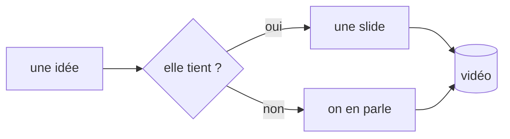

# ardoise

présenter en tapant, sans quitter le clavier

<!-- note: Slide d'ouverture. Laisser respirer 3 secondes avant de parler. Le curseur clignote déjà sur la slide : c'est le sujet. -->

---

## Le problème

Une idée arrive, et il faut trois outils pour la montrer.

<!-- pause -->

- un deck pour la **structure**
- un éditeur pour l'**écrire**
- un terminal pour la **prouver**

<!-- pause -->

::: warn
Trois fenêtres, c'est trois occasions de perdre le fil — et le spectateur avec.
:::

<!-- note: C'est le constat de départ. Ne pas le surjouer : une phrase suffit. -->

---

## Une seule scène

Le deck, la saisie et les commandes vivent dans la même fenêtre.

<!-- pause -->

```text
  dej  k        o        c            :
 ┌───────────┬──────────┬───────────┬──────────┐
 │   deck    │  aperçu  │  saisie   │ commande │
 └───────────┴──────────┴───────────┴──────────┘
```

<!-- pause -->

::: key
Un raccourci par intention : **avancer**, **écrire**, **vérifier**.
:::

---

## Le geste central

`c` ouvre le composeur. Tu tapes. `entrée` ancre le bloc sur la slide.

<!-- pause -->

::: ok
Le public voit l'idée se poser, pas le curseur trembler.
:::

<!-- pause -->

::: note
`tab` change le type de bloc : puce, texte, encadré.
:::

<!-- note: Moment de démonstration. Taper une vraie phrase, pas un exemple. Marquer une pause avant Entrée. -->

---

## L'édition brute

Pour reprendre une slide entière : `e`.

<!-- pause -->

````markdown
## Mon titre

- un point
<!-- pause -->
- révélé au pas suivant
````

<!-- pause -->

::: warn
`échap` **enregistre** — c'est le geste inverse du réflexe habituel.
:::

---

## Les pas

Une slide peut se déplier. C'est écrit dans le markdown, pas cliqué.

<!-- pause -->

```markdown
<!-- pause -->
```

<!-- pause -->

C'est ce marqueur qui vient d'être utilisé deux fois.

---

## Le code, tel quel

```nix
{ pkgs ? import <nixpkgs> {} }:
pkgs.mkShell {
  buildInputs = with pkgs; [ nodejs_22 git ];
  shellHook = ''
    npm install && npm run dev
  '';
}
```

<!-- pause -->

::: ok
La coloration ne dépend d'aucun service : tout est calculé localement.
:::

---

## Un schéma qui se dessine



<!-- pause -->

Le diagramme est du texte : il se modifie pendant la prise.

---

## Le clavier, en une table

| touche | geste |
|---|---|
| `espace` `j` `l` | pas suivant |
| `k` `h` | pas précédent |
| `n` / `p` | slide suivante / précédente |
| `3` `G` | aller à la slide 3 |
| `c` | composer un bloc |
| `e` | éditer la slide brute |
| `b` | écran noir |
| `:` | palette de commandes |

<!-- note: Ne pas lire la table. Montrer deux gestes, laisser l'aide faire le reste. -->

---

## Les quatre thèmes

`:theme paper` pour la lumière du jour, `:theme nord`, `:theme gruvbox`.

<!-- pause -->

::: note
Un thème se change en pleine prise : rien n'est rechargé, rien ne clignote.
:::

---

## Tourner proprement

- `?raw=1` masque le pied de scène pour OBS
- `f` passe en plein écran
- `P` ouvre les notes sur le second écran
- `t` lance le chrono
- `s` télécharge le markdown à jour

<!-- pause -->

::: key
La captation ne voit que la scène. Les notes restent de ton côté.
:::

---

## À toi

Glisse ton propre fichier `.md` sur cette fenêtre, ou remplace `decks/bienvenue.md`.

<!-- pause -->

```bash
npm run dev      # http://localhost:5173
npm run build    # dist/ statique, à ouvrir n'importe où
```

<!-- pause -->

::: ok
Le deck est un fichier texte. Une vidéo, c'est un fichier et son historique git.
:::

