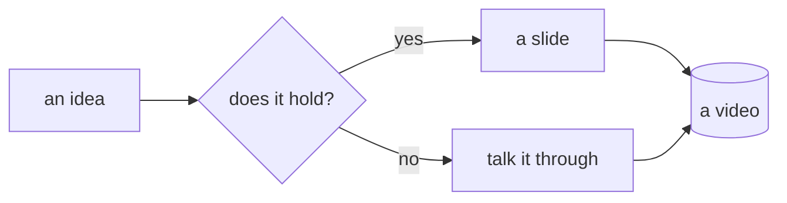

# ardoise

present by typing, without leaving the keyboard

<!-- note: Opening slide. Let it breathe for 3 seconds before talking. The cursor is already in the slide: that is the subject. -->

---

## The problem

An idea shows up, and it takes three tools to show it.

<!-- pause -->

- a deck for the **structure**
- an editor to **write** it
- a terminal to **prove** it

<!-- pause -->

::: warn
Three windows means three chances to lose the thread - and the viewer with it.
:::

<!-- note: This is the opening claim. Do not oversell it: one sentence is enough. -->

---

## One stage

There are no longer two places: the cursor is **inside** the presentation.

<!-- pause -->

- `j` and `k` walk down and up, **paragraph** by paragraph
- a paragraph is a slide step: navigation *is* the pacing
- `w` `b` `h` `l` refine down to the word and the character

<!-- pause -->

::: key
You do not switch between "presenting" and "editing": you change granularity.
:::

---

## Writing in place

`i` types into the text **already styled**. No window opens.

<!-- pause -->

```text
  j  ->  ## A title          i  ->  ## A ti|tle
  (rendered)                      (markdown comes back
                                   under the cursor)
```

<!-- pause -->

::: ok
`esc` hands the line back to the rendering. The rest of the slide has not moved.
:::

<!-- note: Demo moment. Type a real sentence, not an example. -->

---

## Modal, for real

<!-- pause -->

- `w` `b` `e`: next word, previous word, word end
- `0` `$`: start and end of line
- `x`, `d`+motion, `c`+motion: delete, change
- `u`: undo
- `A`, `I`, `O`: end of line, start of line, new paragraph
- `Tab` / `Shift+Tab`: nest or unnest a list item
- `esc`: back to the cursor, without leaving the stage

<!-- pause -->

::: note
Counts work: `3w`, `2x`, `d2w`.
:::

---

## Steps

One paragraph per step, or groups with `<!-- pause -->`. It is written, not clicked.

<!-- pause -->

```markdown
- one point
<!-- pause -->
- the next point
```

<!-- pause -->

`space` jumps to the next group; `j` moves down a single paragraph.

---

## Code, as it is

```nix
{ pkgs ? import <nixpkgs> {} }:
pkgs.mkShell {
  buildInputs = with pkgs; [ nodejs_22 git ];
  shellHook = ''
    npm install && npm run dev
  '';
}
```

<!-- pause -->

::: ok
Highlighting depends on no service: everything is computed locally.
:::

---

## A diagram that draws itself



<!-- pause -->

A diagram is text: it is edited during the take, like everything else.

---

## The keyboard, in one table

| key | gesture |
|---|---|
| `j` / `k` | next / previous paragraph |
| `space` | next step (group) |
| `>` / `<` | next / previous slide |
| `/` / `n` | search, then next match |
| `i` `a` `A` `I` `O` | write, in place |
| `w` `b` `e` | word by word |
| `d` `w` / `c` `w` | delete / change |
| `y` / `p` | yank, paste (`"2p` for older cuts) |
| `u` / `esc` | undo / back to the cursor |
| `.` / `:` | black screen / commands |

<!-- note: Do not read the table. Show two gestures, let the help do the rest. -->

---

## Theme and size

`:theme paper` for daylight, `:theme nord`, `:theme gruvbox`.

<!-- pause -->

- `+` / `-` change the text size in 5% steps
- `:size 120` sets it outright, `:size reset` goes back to 100%
- a deck can declare `theme: paper` in its header

<!-- pause -->

::: note
Both can change mid-take: nothing reloads, nothing flashes.
:::

---

## Recording cleanly

- `?raw=1` hides the stage footer **and the paragraph marker**
- `f` goes fullscreen
- `M` opens the notes on your second screen
- `s` downloads the current markdown

<!-- pause -->

::: key
The capture only sees the slide. The cursor stays your business.
:::

---

## Over to you

Drop your own `.md` file on this window, or start over with `:new`.

<!-- pause -->

```bash
npm run dev      # http://localhost:5173
npm run build    # static dist/, openable anywhere
```

<!-- pause -->

::: ok
A deck is a text file. A video is a file and its git history.
:::
